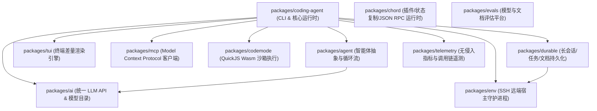

# Pi 项目文件与架构梳理文档

本文档全面梳理当前 `pi` 项目（代码库仓库）的根目录文件、配置文件、脚本工具链以及各核心子包（packages）的目录结构与具体功能作用。

---

## 一、项目概览

`pi` 是一个极简、高度可扩展的 Coding Agent（编码智能体）框架与 CLI 运行时。采用 TypeScript / Node.js（>= 22.19.0）开发的 npm Monorepo 架构，具备以下核心能力：
- 交互式终端 TUI（支持差量渲染、跨平台剪贴板、图片渲染等）
- CLI 批处理与 JSON / RPC 远程模式
- 统一的模型接入层（支持 Anthropic、OpenAI、Google、Bedrock、Ollama、OpenRouter 等）
- 沙箱代码执行（Code Mode QuickJS Wasm）与 MCP（Model Context Protocol）协议客户端
- 持久化会话（Durable）、远程执行环境（Env Daemon）与遥测（Telemetry）

---

## 二、根目录文件及作用

| 文件 / 目录 | 作用说明 |
| :--- | :--- |
| `package.json` | 根工作区配置，定义 monorepo workspaces（`packages/*` 等）、根构建/检查/发布脚本、开发依赖与 Node 引擎版本约束 |
| `package-lock.json` | npm 依赖锁定文件，确保跨环境构建依赖版本严格一致 |
| `tsconfig.json` | 根 TypeScript 项目配置，引用各个子包并开启工程引用模式 |
| `tsconfig.base.json` | 全局基础 TypeScript 配置，定义语法规范、模块解析（NodeNext/Bundler）与编译选项 |
| `biome.json` | Biome 代码格式化与 Linter 配置文件，维护代码质量风格 |
| `vitest.base.ts` | Vitest 单元测试的基础配置，包含路径别名映射与运行环境默认项 |
| `test.sh` | 根测试启动脚本（非 e2e 测试集成运行入口） |
| `pi-test.sh` / `.bat` / `.ps1` | Linux / Windows CMD / PowerShell 下快速运行测试与调试的脚本 |
| `AGENTS.md` | Agent 协作规范与研发规则（含代码风格、命令执行要求、提交规范等） |
| `CONTRIBUTING.md` | 贡献指南，描述新贡献者 Gate 机制、PR 流程与评审标准 |
| `SECURITY.md` | 安全策略与漏洞提报指南 |
| `LICENSE` | 开源许可证文件（MIT） |
| `README.md` | 项目官方介绍、快速上手指南与文档入口 |
| `.npmrc` | npm 运行配置（例如 package-lock、依赖安装策略） |
| `.gitattributes` | Git 属性配置（换行符规范、大文件或合并驱动规则） |
| `.gitignore` | Git 忽略文件规则（过滤 node_modules、dist、临时日志等） |
| `flake.nix` / `flake.lock` | Nix 开发环境与打包环境描述文件 |
| `.github/` | GitHub Actions 工作流（CI/CD、auto-close、发版自动化）、Issue 模板与贡献者白名单 |
| `.husky/` | Git Hooks 配置目录，含 `pre-commit` 钩子（阻断未授权的 lockfile 变更等） |
| `.pi/` | 针对 pi 自身配置的扩展、提示词（prompts）、Git 集成、技能库（skills）等 |
| `nix/` | Nix 打包脚本，包含 `package.nix` 与模型目录映射 `model-catalog.json` |
| `scripts/` | 项目开发、维护、CI 校验、模型目录同步与发版工具脚本集（详见第四节） |
| `packages/` | 核心业务与底层库 Monorepo 子包目录（详见第三节） |

---

## 三、`packages/` 核心包体系及功能

项目划分了 11 个独立的子包，各司其职：

### 1. `packages/coding-agent` (`@earendil-works/pi-coding-agent`)
**定位**：主 CLI 工具与核心智能体调度层。
- `src/main.ts` / `src/cli.ts`：CLI 入口，解析命令行参数并引导启动。
- `src/cli/`：认证交互（`auth-command.ts`）、会话选择（`session-picker.ts`）、模型列表展示、项目信任检查等。
- `src/core/`：核心智能体运行生命周期：
  - `agent-session.ts` / `agent-session-runtime.ts`：会话状态管理与运行时调度。
  - `bash-executor.ts`：本地命令执行器。
  - `compaction/`：上下文窗口压缩与消息折叠算法。
  - `tools/`：内置核心工具（`read` 读取、`edit` 编辑修改、`write` 新建写入、`bash` 终端执行等）。
- `src/modes/`：运行模式适配：
  - `interactive/`：TUI 交互模式。
  - `print-mode.ts`：流式纯文本打印输出模式。
  - `json-event.ts`：机器友好的 JSON 事件流模式。
  - `rpc/`：远程 RPC 服务模式（供外部 IDE 或应用接入）。
- `src/extensions/`：扩展机制支持（MCP、CodeMode、Llama.cpp、工具检索等）。
- `docs/`：完善的开发者与使用文档体系。

### 2. `packages/agent` (`@earendil-works/pi-agent-core`)
**定位**：通用 Agent 底层驱动抽象。
- `src/agent-loop.ts`：LLM 调用与 Tool 执行的核心反馈循环（Agent Loop）。
- `src/agent.ts`：Agent 基础实体，封装系统提示词、状态、消息历史与中断机制。
- `src/stream-fn.ts`：流式响应处理与事件聚合封装。
- `src/proxy.ts`：请求代理与中间件拦截能力。

### 3. `packages/ai` (`@earendil-works/pi-ai`)
**定位**：统一大语言模型（LLM）调用层与动态模型目录。
- `src/api/`：统一请求抽象，屏蔽各模型厂商差异（Anthropic、OpenAI、Gemini、Bedrock、Groq、Ollama、Mistral、DeepSeek 等）。
- `src/auth/`：各大厂商的鉴权机制、OAuth 与 Token 刷新流程。
- `src/models.generated.ts`：根据官方定价与规格自动生成的模型字典元数据。
- `scripts/generate-models.ts`：模型元数据生成脚本（保持模型目录最新）。

### 4. `packages/tui` (`@earendil-works/pi-tui`)
**定位**：高性能终端用户界面（TUI）组件库，支持差量渲染。
- `src/terminal.ts` / `src/tui.ts`：终端底层通信、屏幕状态与主/备屏切换（Alt Screen）。
- `src/components/`：丰富的前端 UI 组件：
  - `editor.ts`：多行富文本编辑器（支持快捷键、撤销栈、语法高亮）。
  - `markdown.ts` / `latex.ts`：Markdown 与 LaTeX 终端排版渲染。
  - `select-list.ts` / `settings-list.ts` / `scroll-view.ts`：列表选择与滚动视口。
  - `image.ts`：六色/Kitty/iTerm2 终端内嵌图片输出。
- `native/`：针对 Windows (C)、Linux (X11) 与 macOS (Obj-C) 的跨平台原生剪贴板及按键修饰符 C/Node-API 扩展模块。

### 5. `packages/codemode` (`@earendil-works/pi-codemode`)
**定位**：安全沙箱化的 JavaScript 执行环境。
- `src/wasm.ts`：基于 QuickJS 编译为 WebAssembly 的极轻量安全沙箱。
- `src/runtime/`：沙箱内严格受控的全局对象注入，仅允许通过确定性的方式调用注入的工具，避免未受限的代码对宿主造成破坏。

### 6. `packages/mcp` (`@earendil-works/pi-mcp`)
**定位**：Model Context Protocol（模型上下文协议）独立客户端。
- `src/client.ts`：MCP 客户端连接与调用主逻辑。
- `src/transports/`：多传输层支持：
  - `stdio.ts`：基于标准输入输出的子进程 MCP 服务连接。
  - `streamable-http.ts`：基于 HTTP / SSE 的远程 MCP 服务连接。
  - `in-memory.ts`：用于单元测试的内存传输通道。
- `src/oauth/`：针对受保护远程 MCP 服务的 OAuth 授权与回调握手。

### 7. `packages/durable` (`@earendil-works/pi-durable`)
**定位**：面向生产级长生命周期的任务、会话和文档持久化运行时。
- `src/session/`：长会话事件溯源与状态持久化。
- `src/tasks.ts` / `src/documents.ts`：任务生命周期状态机与文档管理。
- `src/storage/`：本地与结构化存储后端实现。
- `src/tool-search/`：大规模工具集的向量检索与动态注册。

### 8. `packages/env` (`@earendil-works/pi-env`)
**定位**：Pi Durable 的远程执行环境系统。
- `daemon/`：采用 Rust 编写的轻量宿主守护进程（编译后通过 SSH 部署到远端主机）。
- `src/remote-env.ts` / `src/ssh.ts`：Node.js 客户端，通过 SSH 隧道与远程 daemon 通信，提供远程文件读写、进程启动、命令监视与端口转发。

### 9. `packages/telemetry` (`@earendil-works/pi-telemetry`)
**定位**：中立、零外部依赖的结构化遥测规范与实现。
- `src/metrics.ts`：指标度量采集（计数器、耗时直方图等）。
- `src/memory.ts`：内存数据缓存与诊断导出。
- `src/noop.ts`：默认空实现，保证在无需遥测时零开销。

### 10. `packages/chord` (`@earendil-works/chord`)
**定位**：用于插件隔离、状态副本同步与 JSON-RPC 链路的有类型宿主运行时。
- `src/host.ts` / `src/cluster.ts`：集群与宿主生命周期调度。
- `src/contract.ts`：类型安全的契约接口。
- `src/delta/`：状态变更的差量同步引擎。

### 11. `packages/evals` (`@earendil-works/pi-evals`)
**定位**：Agent 行为、文档与提示词评测套件。
- `evals/`：内置评测用例（自定义 Provider 评测、扩展插件评测、模型文档准确性评测等）。
- `docker/`：隔离执行评测任务的容器镜像与脚本。

---

## 四、`scripts/` 工具脚本目录梳理

根目录下的 `scripts/` 包含完整的工程质量保证与发布自动化体系：

| 分类 | 核心脚本文件 | 功能说明 |
| :--- | :--- | :--- |
| **质量检查与依赖审查** | `check-pinned-deps.mjs` | 校验依赖版本是否均已严格 Pin 住（禁止随意宽松匹配） |
| | `check-runtime-deps.mjs` | 校验运行时依赖纯洁性，防止漏标或冗余依赖 |
| | `check-ts-relative-imports.mjs` | 规范并检查 TypeScript 相对导入路径格式 |
| | `check-entry-graphs.mjs` | 分析各子包入口引用图谱，确保没有非法 cross-package 循环引用 |
| | `check-lockfile-commit.mjs` | 预提交钩子校验，防止无意提交 `package-lock.json` |
| | `biome-check.mjs` | 批量运行 Biome 语法和格式化扫描 |
| **模型目录治理** | `diff-model-catalog.mjs` | 比对当前模型目录与上游更新的差异 |
| | `update-model-catalog-pin.mjs` | 更新本地固化的模型版本目录 Pin 值 |
| | `publish-model-catalog.mjs` | 独立打包并发布模型目录服务 |
| **打包与编译构建** | `build-coding-agent-bundle.mjs` | 使用 esbuild 将 `coding-agent` 打包为独立执行脚本 bundle |
| | `build-binaries.sh` | 编译各平台二进制可执行分发包 |
| | `generate-coding-agent-install-lock.mjs` | 生成安装专用的安全 lock 校验清单 |
| **冒烟与端到端测试** | `coding-agent-smoke.mjs` | CLI 核心功能本地冒烟测试 |
| | `check-browser-smoke.mjs` | 浏览器环境适配冒烟测试（支持 Web 端应用接入） |
| | `smoke-test-codemode-binary.mjs` | CodeMode Wasm 运行冒烟测试 |
| **发布与发版流** | `release.mjs` | 统一发版流水线（patch/minor/major 一键切分支提标） |
| | `sync-versions.js` | 保持 Monorepo 内部子包版本号一致性 |
| | `publish.mjs` / `pack-packages.mjs` | 校验并发布至 npm 仓库 |
| | `release-notes.mjs` | 自动解析 CHANGELOG 提取并修剪 Release Notes |
| **统计与监控分析** | `cost.ts` / `stats.ts` | Token 消耗、成本计算与上下文体积分析工具 |
| | `tool-stats.ts` / `edit-tool-stats.mjs` | 工具调用频率与编辑质量分析统计 |

---

## 五、总结与架构设计哲学

整个 `pi` 仓库的代码设计遵循了极强的工程约束：
1. **轻量解耦**：核心能力按边界严格拆分为单独的子包，`tui`、`mcp`、`ai` 均可单独发布使用。
2. **极速启动与零开销**：避免厚重抽象与不必要的动态分配，终端差量更新保障极高交互帧率。
3. **原生跨平台兼容**：针对 Windows、macOS 和 Linux 差异（如剪贴板、伪终端、ANSI 处理）分别提供原生适配与测试用例。
4. **安全与确定性**：依赖严格 Pin 住版本，代码沙箱化执行（QuickJS Wasm），长效持久化与审计追踪。
