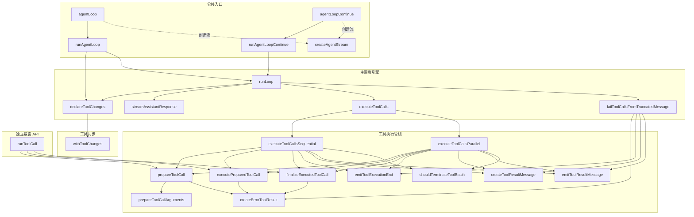
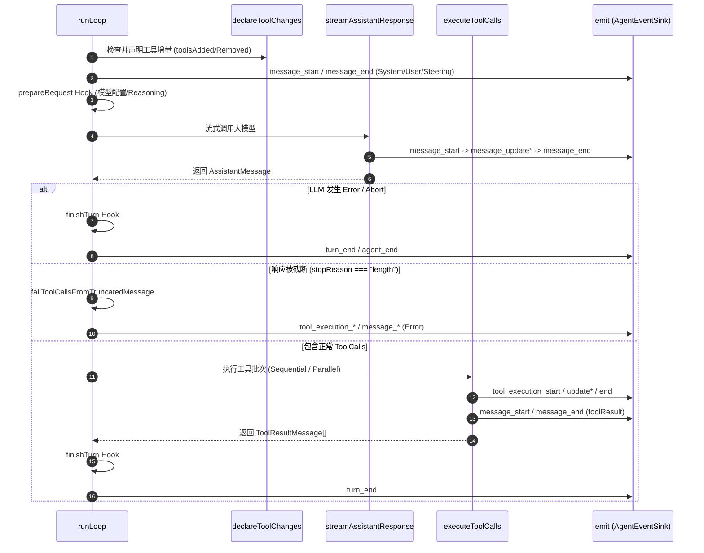
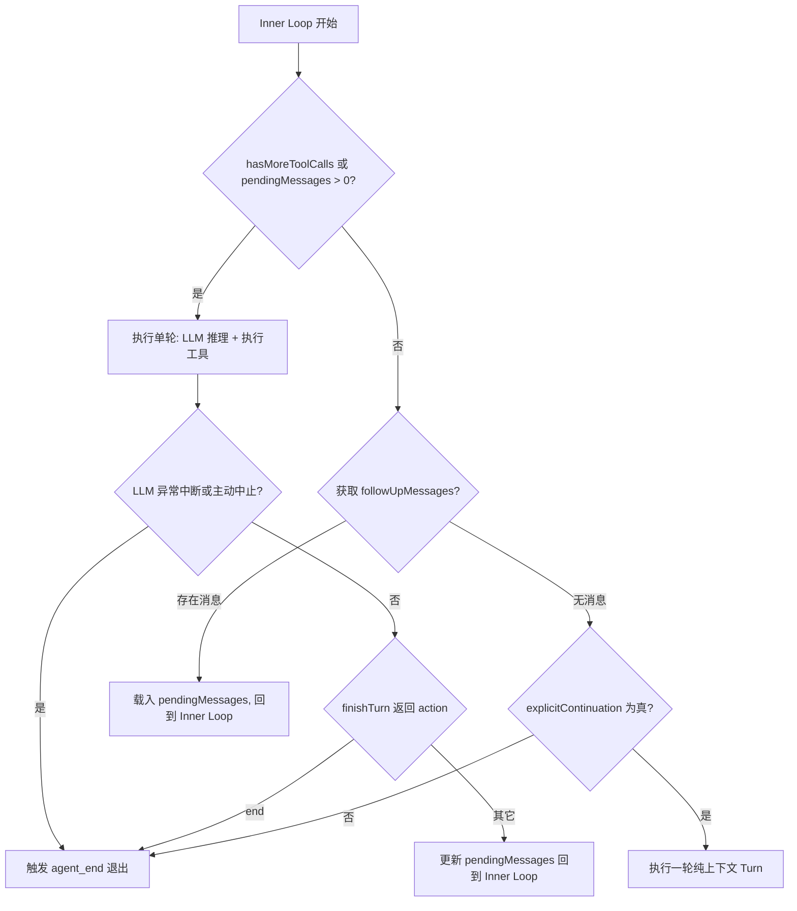

# agent-loop.ts 深度解析

## 1. 核心作用与职责

`packages/agent/src/agent-loop.ts` 是 Agent 运行时的核心调度驱动引擎。其主要职责为：

1. **会话全生命周期调度**：管理从 Prompt 提交（或中途继续 Continue）到多轮交互收敛退出的完整执行循环（Agent Loop）。
2. **消息模型边界隔离**：在 Agent 内部流转全程使用高阶抽象的 `AgentMessage[]`，仅在向大模型（LLM）发起请求的边界处，通过 `convertToLlm` 转换为 LLM 协议要求的 `Message[]`。
3. **工具动态增量声明（Tool Loadout Sync）**：对比当前上下文（Transcript）已声明的工具与运行时实际可执行工具集合（`context.tools`），自动生成并注入 `toolsAdded`/`toolsRemoved` 的系统消息，保持声明与实现同步。
4. **双层循环控制与动态介入**：
   - **外层循环**：处理 Agent 停机后的 Follow-up 消息（延时跟进消息）或显式续行决策。
   - **内层循环**：处理当前 Turn 下的 Steering Messages（用户打断/引导指令）、下一轮上下文编排（Compaction 等）、LLM 调用以及工具调用批次执行。
5. **健壮的工具调用管线**：支持并发执行（Parallel）与严格串行执行（Sequential），提供参数预处理、Schema 校验、`beforeToolCall` 拦截鉴权、流式更新 Sink、`afterToolCall` 结果改写，并针对 LLM 输出截断（`stopReason === "length"`）提供防破坏性执行保护。
6. **事件流派发**：通过 `EventStream` 对外流式推送 Agent 生命周期事件（`agent_start`/`end`、`turn_start`/`end`、`message_*`、`tool_execution_*` 等）。

---

## 2. 函数全景与功能说明

| 函数名 | 访问控制 | 核心功能 |
|---|---|---|
| `agentLoop` | `export` | 入口函数：携带新 Prompts 启动循环，创建并返回 `EventStream`。 |
| `agentLoopContinue` | `export` | 入口函数：从已有 Context 继续运行（重试或追加调用），校验末尾非 assistant 角色并启动流。 |
| `runAgentLoop` | `export` | 异步执行体：处理初始工具声明并派发事件，转交 `runLoop` 执行。 |
| `runAgentLoopContinue` | `export` | 异步执行体：校验上下文后派发初始事件，转交 `runLoop` 执行。 |
| `runToolCall` | `export` | 独立工具调用接口：复用与循环内相同的参数准备、校验、前后钩子管线，供内部嵌套工具调用。 |
| `createAgentStream` | 内部 | 创建与 `agent_end` 事件绑定的 `EventStream` 实例。 |
| `runLoop` | 内部核心 | 双层状态机主循环：驱动 Turn 转换、Hook 拦截、模型推理与工具执行批处理。 |
| `declareToolChanges` | 内部 | 计算 `context.tools` 与已有上下文中的工具差异，在合适位置生成/修饰 System 消息。 |
| `withToolChanges` | 内部 | 不可变更新 System 消息的 `toolsAdded` / `toolsRemoved` 字段。 |
| `streamAssistantResponse` | 内部 | 消息转换边界：调用 `transformContext` 与 `convertToLlm`，触发 `streamFunction` 并派发流式消息事件。 |
| `executeToolCalls` | 内部 | 分发器：根据配置及工具本身的 `executionMode` 选择串行或并行执行器。 |
| `executeToolCallsSequential` | 内部 | 串行管线：逐个运行工具的准备、执行与结果后处理。 |
| `executeToolCallsParallel` | 内部 | 并行管线：逐个准备（支持即时退出），并行并发执行工具并保持原始顺序输出。 |
| `prepareToolCall` | 内部 | 查找工具、运行 `prepareArguments`、校验 Schema，并触发 `beforeToolCall` 钩子。 |
| `prepareToolCallArguments` | 内部 | 工具级参数自定义预转换（`tool.prepareArguments`）。 |
| `executePreparedToolCall` | 内部 | 调用 `tool.execute`，度量执行耗时，桥接流式增量回调。 |
| `finalizeExecutedToolCall` | 内部 | 运行 `afterToolCall` 钩子，支持修改返回内容、屏蔽结构化输出或标记终结。 |
| `failToolCallsFromTruncatedMessage`| 内部 | 当大模型因达到 Token 上限截断时，将所有未决工具调用以错误状态标记，防止破坏性执行残缺参数。 |
| `shouldTerminateToolBatch` | 内部 | 检查工具批次结果中是否所有结果均要求 `terminate === true`。 |
| `createErrorToolResult` | 内部 | 构造格式化的报错工具返回对象。 |
| `createToolResultMessage` | 内部 | 将工具最终状态转化为标准的 `ToolResultMessage`。 |
| `emitToolExecutionUpdate` | 内部 | 创建并返回向事件汇推送流式增量事件的闭包回调。 |
| `emitToolExecutionEnd` | 内部 | 派发 `tool_execution_end` 事件。 |
| `emitToolResultMessage` | 内部 | 派发工具结果消息的 `message_start` 与 `message_end` 事件。 |

---

## 3. 函数调用关系结构

### 3.1 核心调用层次图

---

## 4. 关键控制流与生命周期时序

### 4.1 Turn 内部执行时序

### 4.2 循环退出判断逻辑

